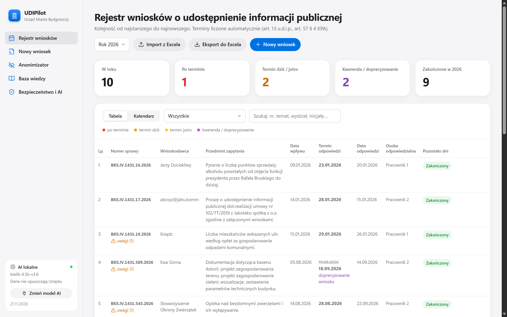
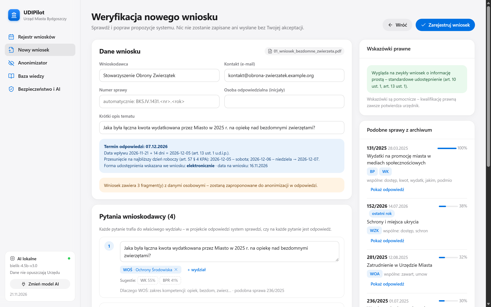
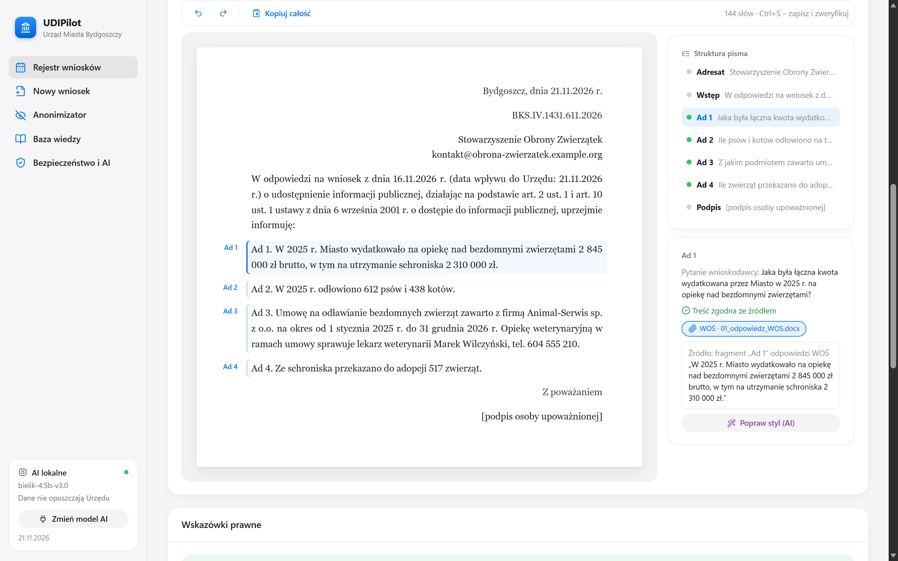
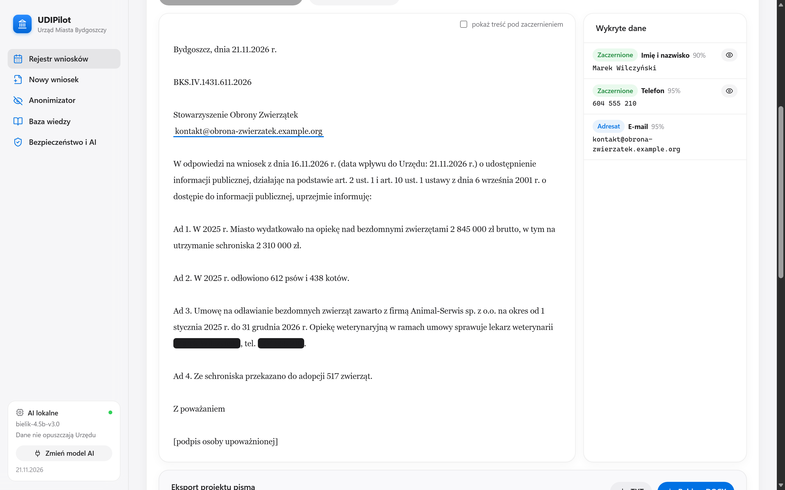
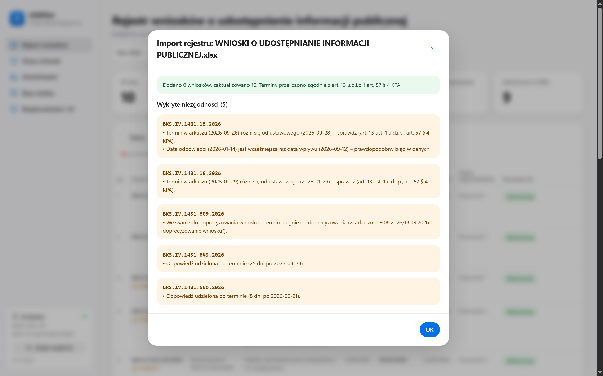
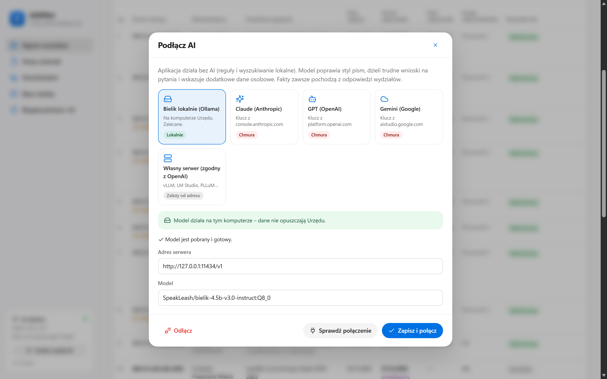

# UDIPilot – Inteligentny Asystent Urzędnika

Prototyp na HackNation 2026 (wyzwanie Urzędu Miasta Bydgoszczy): **rejestr i kalendarz wniosków UDIP + generator projektów odpowiedzi + anonimizacja danych**.
Działa **w 100% offline** (reguły, wyszukiwanie lokalne). Model językowy jest opcjonalny i podłączany przyciskiem **„Podłącz AI”** – domyślnie lokalny **Bielik** (Ollama), opcjonalnie do testów Claude / GPT / Gemini (z ostrzeżeniem, że dane opuszczają Urząd).

| Rejestr i kalendarz wniosków | Nowy wniosek: pytania, wydziały, podobne sprawy |
|---|---|
|  |  |
| **Projekt pisma: edytor z kontrolą źródeł** | **Anonimizacja: dane fizycznie usunięte** |
|  |  |
| **Import arkusza UMB z wykrytymi niezgodnościami** | **„Podłącz AI”: lokalny Bielik domyślnie** |
|  |  |

> 🎬 **Film demo (3 min):** https://youtu.be/sH8Qo3IfCAs
>
> **Dla jury – najszybciej:** Code → Download ZIP → rozpakuj → `INSTALUJ.bat` → w kreatorze **Zainstaluj** → **Uruchom UDIPilot** (http://localhost:3000). Szczegóły i rozwiązywanie problemów: [docs/JAK_URUCHOMIC.md](docs/JAK_URUCHOMIC.md).

## Szybki start

**Instalacja jednym kliknięciem:** pobierz repozytorium (Code → Download ZIP), rozpakuj i uruchom **`INSTALUJ.bat`** (Windows) lub **`./instaluj.sh`** (macOS/Linux). Otworzy się **kreator instalacji w przeglądarce** (styl aplikacji): kontrola komputera, przełączniki opcji (lokalny Bielik, skrót na pulpicie), postęp każdego kroku z paskiem pobierania modelu i przycisk **Uruchom UDIPilot**. Brakujący Node.js instalowany jest automatycznie (winget/Homebrew). Kreator: `installer/` – tylko moduły wbudowane Node.js. Kolejne uruchomienia: **`URUCHOM.bat`** / `./uruchom.sh`.

Ręcznie:

Wymagania: Node.js ≥ 22.5 (wbudowany SQLite). Bez Dockera, bez GPU, bez Internetu w trakcie pracy.

```bash
npm run setup      # instalacja, build frontendu, dane testowe
npm start          # http://127.0.0.1:3000
```

Docker (on-premise): `docker compose up -d` → http://localhost:3000
Z lokalnym modelem: `docker compose --profile ai up -d` i ustaw `LLM_BASE_URL=http://ollama:11434/v1`, `LLM_MODEL=…` (patrz `.env.example`).

Tryb deweloperski: `npm run dev` (API) + `npm run dev:client` (Vite, http://localhost:5173).
Testy: `npm test`. Pliki do testów jury: `samples/` (generowane `npm run samples`).

**Instrukcja uruchomienia krok po kroku: [docs/JAK_URUCHOMIC.md](docs/JAK_URUCHOMIC.md)**

## Jak jury może przetestować (scenariusz z opisu zadania)

| Test z regulaminu | Gdzie w aplikacji |
|---|---|
| 1. Wgranie wniosku PDF/Word → podobne sprawy | **Nowy wniosek** → wgraj `samples/wniosek_place_zabaw.pdf` → panel „Podobne sprawy z archiwum” |
| 2. Odpowiedź wydziału → projekt pisma | Sprawa → zakładka **2** (wgraj `samples/odpowiedz_WGK_place_zabaw.docx`, `odpowiedz_BCB_monitoring.docx`) → zakładka **3** „Generuj projekt” |
| 3. Plik z danymi osobowymi → anonimizacja | **Anonimizator** → `samples/dokument_z_danymi_osobowymi.docx`, lub zakładka **4** w sprawie |
| 4. Łatwość obsługi, stabilność | prowadzenie krok po kroku, statusy aktualizowane automatycznie |
| 5. Kalendarz: 10 wniosków, kolejność, podświetlenie | **Rejestr wniosków** (tabela + widok kalendarza), kolory: po terminie / dziś / jutro / kwerenda |
| 6. Wgrywanie ustaw i archiwalnych odpowiedzi | **Baza wiedzy** (PDF/DOCX/TXT, import JSON) |

Gotowa sprawa demo: **BKS.IV.1431.603.2026** (termin w najbliższy dzień roboczy, odpowiedź WAB wgrana, brak odpowiedzi WGK na pyt. 4 – system to wykrywa).

## Materiały Urzędu Miasta Bydgoszczy (wykorzystane)

- **Schemat kalendarium** (`samples/umb/WNIOSKI O UDOSTĘPNIANIE INFORMACJI PUBLICZNEJ.xlsx`) – 10 wniosków testowych jest wczytywanych do rejestru; **import i eksport XLSX w tym samym układzie kolumn** (Lp., Numer sprawy, Wnioskodawca, Przedmiot zapytania, Data wpływu, Termin odpowiedzi, Data odpowiedzi, Osoba odpowiedzialna, Pozostało dni). Przy imporcie system przelicza terminy ustawowe i **wskazuje niezgodności w arkuszu** (termin niezgodny z ustawą, odpowiedź po terminie, data odpowiedzi przed datą wpływu, „doprecyzowanie wniosku”).
- **Zarządzenie nr 536/2024** Prezydenta Miasta Bydgoszczy – w bazie wiedzy; procedura AIP → wydziały (§ 9–11) odwzorowana w treści zapytań do wydziałów (termin, adres bip@um.bydgoszcz.pl, anonimizacja przed przekazaniem, informacja przetworzona, projekt decyzji odmownej).
- **Dane podlegające anonimizacji** – cały katalog obsługiwany przez anonimizator (w tym dane szczególne: zdrowie, sytuacja rodzinna i majątkowa, pomoc społeczna, poglądy, karalność, miejsce urodzenia, nr działki, tajemnica przedsiębiorstwa; NIP firm traktowany jako jawny).
- Numeracja spraw w formacie UMB: `BKS.IV.1431.<nr>.<rok>`.

## Funkcje

- **Rejestr i kalendarz** – kolumny jak w arkuszu UMB + status i wydziały, wybór roku, import/eksport Excel; widok miesięczny ze świętami.
- **Doprecyzowanie wniosku** – wezwanie wstrzymuje termin; po wpływie doprecyzowania termin 14 dni liczony od nowa; gotowe pismo z wezwaniem.
- **Terminy liczone zgodnie z prawem** – 14 dni (art. 13 ust. 1 u.d.i.p.), przesunięcie z soboty/święta (art. 57 § 4 KPA, w tym Wigilia od 2025 r.), kwerenda maks. 2 miesiące (art. 13 ust. 2) z walidacją.
- **Statusy** – brak działań → zapytania do wydziałów → kwerenda → odpowiedź przygotowana → wysłana; aktualizowane automatycznie przy każdym kroku, pełna historia sprawy.
- **Podział wniosku na pytania** i **propozycja wydziałów** UMB (lista z BIP) – kompetencje + „głos” podobnych spraw z archiwum + kontekst poprzedniego pytania; z uzasadnieniem.
- **Treść zapytania do wydziału** z terminem wewnętrznym (do skopiowania – system niczego nie wysyła).
- **Projekt odpowiedzi** – 6 typów pism: udostępnienie, zawiadomienie o przedłużeniu, wezwanie (informacja przetworzona), odesłanie do BIP, „to nie jest informacja publiczna”, szkielet decyzji odmownej z pouczeniem.
- **Ochrona przed halucynacjami** – treść merytoryczna wyłącznie z odpowiedzi wydziałów, przy każdym akapicie źródło; automatyczna weryfikacja zdań bez pokrycia i **liczb spoza źródeł**; wykrywanie pytań bez odpowiedzi.
- **Edytor pisma** – całe pismo w jednym dokumencie (jak w Wordzie), sekcje „Ad N” na marginesie, chronione granice sekcji, panel ze strukturą pisma i źródłem akapitu, Ctrl+S = zapisz i zweryfikuj.
- **Anonimizacja** – PESEL/NIP/REGON/IBAN z sumami kontrolnymi, telefon, e-mail, adres, dowód, data urodzenia, nr rej., KW, imiona i nazwiska (słownik + odmiana + kontekst), ostrzeżenie dla osób pełniących funkcje publiczne. Propozycje na szaro → po akceptacji na czarno; ręczne zaznaczanie myszką; spójne aliasy (Osoba A, B…). W DOCX dane są **fizycznie usuwane**.
- **Uczenie na danych Urzędu** – wysłane odpowiedzi trafiają (po anonimizacji) do archiwum i są podpowiadane przy kolejnych wnioskach; baza wiedzy przyjmuje ustawy, zarządzenia i archiwum.

## Architektura

```
React (Vite) ──REST──> Node.js / Express
                         ├─ lib/analysis   – metadane, pytania, typ sprawy, routing do wydziałów
                         ├─ lib/deadlines  – terminy, święta, kwerenda
                         ├─ lib/text       – BM25, stemming PL, podział na zdania
                         ├─ lib/draft      – szablony pism, mapowanie „Ad N”, weryfikacja źródeł
                         ├─ lib/anonymize  – detektory + sumy kontrolne + aliasy
                         ├─ lib/exporter   – DOCX/TXT z fizycznym usunięciem danych
                         ├─ lib/llm        – opcjonalny model (API zgodne z OpenAI: Ollama/vLLM)
                         └─ SQLite (node:sqlite) – wnioski, pytania, odpowiedzi, projekty, wiedza, historia
```

Skalowanie: setki/tysiące archiwalnych dokumentów – indeks BM25 w pamięci (ms); przy dziesiątkach tysięcy – PostgreSQL + pgvector/embeddingi (`sdadas/mmlw-roberta-large`) bez zmiany interfejsu.

## AI w zamkniętym środowisku

| Element | Domyślnie | Z modelem lokalnym |
|---|---|---|
| Terminy, statusy, kalendarz | reguły | – |
| Podobne sprawy, wydziały | BM25 + archiwum | (opcj.) embeddingi |
| Podział na pytania | reguły | LLM |
| Projekt pisma | szablony + treść wydziałów | LLM tylko redaguje styl, wynik weryfikowany |
| Anonimizacja | reguły + sumy kontrolne | LLM jako 2. warstwa |

**Przetestowane lokalnie:** Ollama 0.40 + `SpeakLeash/bielik-4.5b-v3.0-instruct:Q8_0` (5,1 GB) na laptopie z RTX 3060 6 GB – podział wniosku na pytania ok. 4 s, redakcja akapitu 1–3 s, druga warstwa anonimizacji ok. 8 s. Konfiguracja: przycisk **Podłącz AI** w lewym dolnym rogu (wykrywa Ollama, pobiera Bielika z paskiem postępu, test połączenia) – ustawienia zapisywane lokalnie w `data/settings.json`; alternatywnie zmienne `LLM_BASE_URL` / `LLM_MODEL` w `.env`. Redakcja przez model to zawsze propozycja „przed/po” do akceptacji – model potrafi subtelnie zmienić sformułowanie.

**Modele w chmurze (tylko do testów):** Claude (oficjalne SDK `@anthropic-ai/sdk`, domyślnie `claude-opus-5-5` z fallbackiem po stronie serwera), GPT (OpenAI), Gemini (Google) lub dowolny serwer zgodny z OpenAI. Wybranie modelu w chmurze wymaga zaznaczenia potwierdzenia ryzyka (dane wniosków, także osobowe, trafiają do zewnętrznego dostawcy – RODO); panel boczny świeci wtedy na czerwono „AI w chmurze”. Klucze API są przechowywane tylko lokalnie i maskowane w interfejsie.

Rekomendowany model docelowy (serwer Urzędu): **Bielik-11B-v2.x-Instruct** (Ollama/vLLM, 1× GPU 24 GB) lub **PLLuM**; bez GPU – Bielik 4.5B/1.5B w kwantyzacji Q4 na CPU.

## Bezpieczeństwo

- brak automatycznej wysyłki i integracji zewnętrznych; ostateczna decyzja zawsze po stronie urzędnika,
- pliki przetwarzane w pamięci, limit 20 MB, walidacja formatów,
- treść wniosków izolowana od instrukcji modelu (prompt injection),
- nagłówki bezpieczeństwa, historia działań w każdej sprawie,
- wdrożenie: AD/LDAP + role, TLS przez reverse proxy, szyfrowanie wolumenu z bazą.

## Rozwiązania zewnętrzne (§ 4 ust. 1 regulaminu)

- Biblioteki open source: Express, Multer, React, Vite, unpdf (pdf.js), mammoth, docx, pdfkit (tylko do generowania plików testowych).
- Lista wydziałów i biur UMB – z BIP Urzędu Miasta Bydgoszczy.
- Kod przygotowany z pomocą asystenta AI (Claude); koncepcja, testy i decyzje – zespół LIPSTICK.

## Ograniczenia prototypu

- Brak OCR skanów (w wersji docelowej: lokalny Tesseract `pol`); stary `.doc` – konwersja do DOCX.
- Teksty ustaw w bazie to robocze streszczenia – do zastąpienia pełnymi tekstami z ISAP.
- Kwalifikacja prawna (typ odpowiedzi) jest podpowiedzią, nie rozstrzygnięciem.
- Brak logowania/ról w prototypie (zaprojektowane do wdrożenia).
- Wszystkie dane testowe są fikcyjne.
